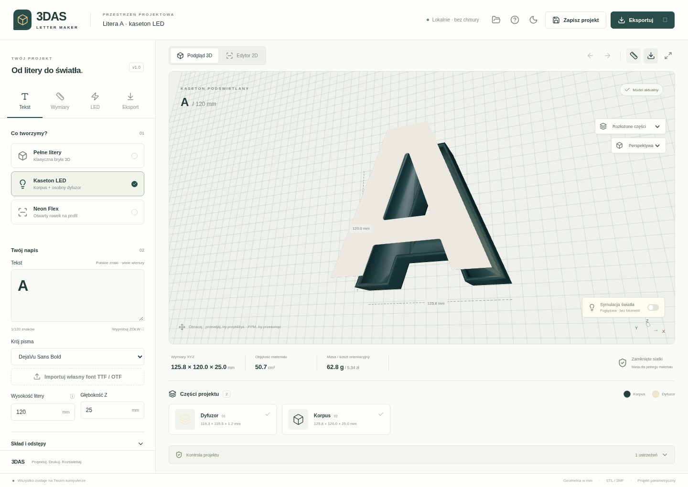

# 3DAS Letter Maker

Lokalna aplikacja CAD do generowania drukowalnych liter pełnych, pustych kasetonów LED z osobnym dyfuzorem oraz otwartych kanałów Neon Flex. Interfejs jest po polsku. Podgląd Three.js i eksport korzystają z **tych samych siatek** obliczanych przez Python, a nie z osobno odtwarzanego tekstu w przeglądarce.



## Pobieranie z GitHub

Pobierz [gotowy pakiet ZIP](downloads/3DAS-Letter-Maker.zip). Na stronie pliku użyj przycisku **Download raw file** (ikona pobierania). Pakiet zawiera źródła, zbudowany interfejs, fonty z licencją, przykłady STL/3MF i instrukcję instalacji.

Możesz też pobrać cały kod repozytorium przez **Code → Download ZIP**. Po rozpakowaniu uruchom `install.bat`, a następnie `start.bat`.

## Uruchomienie na Windows x64

1. Zainstaluj **Python 3.12 x64** i **Node.js 22 lub 24 LTS**, dodając je do PATH.
2. Uruchom `install.bat` (pierwsza instalacja wymaga Internetu).
3. Uruchom `start.bat`. Aplikacja otworzy przeglądarkę po potwierdzeniu gotowości API.

Frontend produkcyjny jest podawany przez FastAPI z tego samego adresu lokalnego. Nie trzeba konfigurować portów, kont, kluczy API ani edytować kodu. Zamknij serwer przez Ctrl+C. Ścieżki ze spacjami są uwzględnione w skryptach.

**Zakres weryfikacji:** aplikację, build i testy wykonano w Linux/Python 3.12/Node 24/Chromium. Potwierdzono dostępność wszystkich przypiętych pakietów binarnych dla Windows x64/Python 3.12. Skryptów BAT/PowerShell nie uruchomiono na rzeczywistym Windows; ich weryfikacja na Windows pozostaje do wykonania.

## Linux / środowisko chmurowe

```bash
cd /workspace/generator
bash scripts/install.sh
bash scripts/start.sh
```

Instalacja tworzy `.venv`, instaluje przypięte zależności z `requirements.txt`, wykonuje `npm ci` z lockfile i buduje frontend. Skrypty niczego nie wysyłają do zewnętrznych usług.

Rozwój z automatycznym odświeżaniem obu części:

```bash
.venv/bin/python scripts/dev.py
```

Na Windows odpowiednik to `.venv\Scripts\python.exe scripts\dev.py`. API udostępnia interaktywny opis pod ścieżką `/docs`. Szczegóły: [instalacja](docs/INSTALLATION.md).

## Pierwsza litera LED

1. Pozostaw domyślny napis **A**, kaseton LED, wysokość 120 mm i głębokość 25 mm.
2. Parametry konstrukcyjne: ścianki i tył 2 mm, front 1,2 mm, półka szerokości 1 mm i grubości 1,2 mm, luz frontu **0,25 mm na stronę**.
3. W zakładce LED wybierz taśmę 10 mm lub sztywną listwę PCB, a następnie „Zaproponuj rozmieszczenie”. Dodaj otwór przewodu; przesuń elementy w edytorze 2D lub wpisz współrzędne i obrót.
4. Obejrzyj korpus, dyfuzor, przekrój i złożenie. Popraw błędy kontroli. Rozmiar stołu i temperatura LED są osobnymi ostrzeżeniami.
5. W Eksport pobierz ZIP z osobnymi STL, złożeniem 3MF, układem do druku i projektem JSON. Najpierw wydrukuj test luzów.

Gotowy przykład: [projekt A 120 mm z listwą PCB 10 × 30 mm](examples/A_LED_120/A_LED_120.json), [pakiet modeli ZIP](examples/A_LED_120/A_LED_120.zip), [korpus STL](examples/A_LED_120/A_BODY.stl), [front STL](examples/A_LED_120/A_DIFFUSER.stl), [złożenie 3MF](examples/A_LED_120/A_LED_120_ASSEMBLY.3mf), [test luzów](examples/TOLERANCE.zip).

## Dostępne funkcje

- HarfBuzz i fontTools: kerning, polskie znaki, małe/wielkie litery, cyfry, interpunkcja, wiele wierszy, 3 fonty DejaVu z licencją i import TTF/OTF (do 10 MB). Brakujący font zatrzymuje odczyt zamiast podmiany.
- Wymiary w mm, niezależna szerokość, zadana szerokość napisu, skalowanie proporcjonalne, odstępy, łączniki liter i akcentów, wspólna tylna płyta, zaokrąglanie obrysu XY.
- Rzeczywiście puste kasetony, dno, ścianki, półki, osobne dyfuzory, regulowany luz i opcjonalny kołnierz pozycjonujący.
- LED/COB/PCB: bezpieczne propozycje prostych sekcji, edytor 2D, prowadnice, uchwyty i podstawki PCB z otworami. Własne wymiary, liczba mocowań i planowane wyjście przewodu.
- Przelotowe otwory przewodów/śrub i keyhole, kieszenie magnesów, dystanse, kanały przewodów, miejsca złączek. Kieszenie/kanały zachowują co najmniej 0,6 mm dna.
- Neon Flex: szkielet medialny rozdzielany na sekcje przy rozgałęzieniach, ręczna edycja węzłów, styczne łuki, skracanie do wielokrotności cięcia. Złe trasy blokują eksport.
- Kontrola zamknięcia i orientacji siatek, objętości, kolizji komponentów, głębokości, odłączonych i małych elementów, zaniku detali oraz stołu drukarki. Segmentacja z osobnymi dwukołkowymi łącznikami i ślepymi gniazdami.
- STL, prawdziwy 3MF Core/OPC z osobnymi obiektami i materiałami bazowymi, ZIP, pełny projekt JSON, zapis lokalny i lista ostatnich projektów, presety przeglądarki, undo/redo, motywy, PNG, objętość/masa/koszt.

## Weryfikacja

```bash
.venv/bin/python -m pytest -q
npm --prefix frontend run build
# Uruchom aplikację w osobnym terminalu, następnie:
npm --prefix frontend run test:e2e
.venv/bin/python scripts/generate_examples.py
```

Testy geometrii obejmują wszystkie 15 obowiązkowych scenariuszy: A/B/O, Ł, ŻÓŁW, 3DAS, pusty korpus, odrzucony LED, rzeczywistą zmianę objętości ścianek, ponowny odczyt STL/3MF, JSON, A1 mini, podparcie frontu, PCB i Neon Flex. 3MF przechodzi również **niezależny lib3mf w trybie ścisłym**, bez ostrzeżeń. Testy Playwright obejmują działający WebGL, edycję LED, eksport, blokadę błędów, JSON, Neon i telefon. [Raport testów](docs/TESTS.md).

## Granice wersji i próby fizyczne

Podstawowe zamknięcie to osadzony front do wklejenia. **Nie zaimplementowano zatrzasków, fazy krawędzi Z, przestrzennej trasy Neon Flex z gięciem pionowym ani podziału zintegrowanej płyty tylnej.** Te funkcje nie mają pozornie działających przycisków. Szczegółowe ograniczenia algorytmów opisano w [architekturze](docs/ARCHITECTURE.md).

Nie przeprowadzono testów w OrcaSlicer/Bambu Studio ani fizycznych wydruków. Pliki nie zawierają profilu druku, ustawień AMS ani zweryfikowanego przypisania ekstruderów. Przed wykonaniem napisu sprawdź w swoim slicerze: osobne obiekty/kolory, orientację, tolerancję frontu i kołków, rozmiar podłoża, wytrzymałość mocowań, wymiary rzeczywistej listwy i temperaturę LED.

Masa jest liczona z objętości bryły i gęstości pełnego materiału, bez ustawień wypełnienia i strat. Światło jest symulacją poglądową. Kalkulator mocy nie dobiera zasilacza.

## Dokumentacja

- [Instrukcja użytkownika](docs/USER_GUIDE.md)
- [Parametry](docs/PARAMETERS.md)
- [Architektura i kontrakt API](docs/ARCHITECTURE.md)
- [Instalacja i diagnozowanie](docs/INSTALLATION.md)
- [Testy i ograniczenia walidacji](docs/TESTS.md)
- [Przykłady](examples/README.md)

Fonty: [licencja DejaVu](backend/fonts/LICENSE-DejaVu.txt). Zależności mają własne licencje; własne fonty importuj z odpowiednim prawem do użycia.
